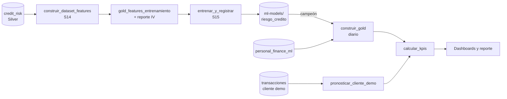

# 08 — Dataset para IA y modelo predictivo (Semanas 14–15)

> **Página ejecutiva (1 minuto)**
>
> - **Qué hace:** estima la **probabilidad de que cada cliente con préstamo no pague** (PD), explica **por qué** (las 3 razones principales) y la convierte en el índice de riesgo y los KPIs del tablero.
> - **Con qué aprende:** ~32 mil préstamos públicos **con resultado conocido** (pagó / no pagó). Tus clientes no traen ese dato, por eso se entrena con otra fuente y se adapta con cuidado.
> - **Qué NO usa:** género ni edad. Solo se usan para **auditar** que el modelo no discrimine.
> - **Qué tan bueno es:** se mide con **Gini** (estándar de riesgos) en datos que el modelo nunca vio. Solo pasa a producción si supera las pruebas de negocio y no empeora al modelo anterior.
> - **Pronóstico:** además, para un **cliente demo** con 5 años de historial, proyecta ingreso, gasto y ahorro a 6 meses y mide qué tan estables son.

---

## 1. Ficha del dataset (*datasheet*) — Semana 14

| Aspecto | Detalle |
|---|---|
| Fuente etiquetada | `credit_risk` — Kaggle `laotse/credit-risk-dataset` (~32.5 K préstamos, `loan_status` 1 = impago, ~22% de impago) |
| Fuente a calificar | `personal_finance_ml` — la cartera (sin etiqueta de impago) |
| Contrato | [`config/features.yml`](../config/features.yml) — definición, fórmula de cada lado, unidad, rango, monotonía, motivo de exclusión |
| Implementación | `scripts/features.py` · DAG `entrenamiento_modelo_dag` (tarea `construir_dataset_features`) |
| Salidas (gold-layer) | `gold_features_entrenamiento` (con target y partición), `reporte_seleccion_variables`, `_features_metadata/<fecha>.json`, `gold_features_cartera` (diario, en `construir_gold`) |
| Versión | `version_dataset` = hash del contenido; `version_contrato` del YAML |

### 1.1 Limpieza previa (Silver, `bronze_to_silver.py`)

Cuarentena de defectos conocidos del dataset: edades imposibles (p. ej. 144), antigüedad laboral de más de 60 años, `loan_percent_income` fuera de [0, 1], tasas fuera de [0, 40]. Duplicados exactos removidos. Las tasas nulas (~10%) se conservan y el modelo las trata como categoría propia.

### 1.2 Principio de paridad

Una variable solo entra al modelo si se calcula **igual** en el entrenamiento y en la cartera. Por eso se usan ratios y escalas logarítmicas, no dólares absolutos.

| Feature | Entrenamiento | Cartera | Monotonía exigida |
|---|---|---|---|
| `ratio_prestamo_ingreso` | `loan_amnt / person_income` | `loan_amount_usd / (monthly_income_usd × 12)` | ↑ riesgo |
| `ingreso_anual_log` | `log(1 + person_income)` | `log(1 + monthly_income_usd × 12)` | — |
| `monto_prestamo_log` | `log(1 + loan_amnt)` | `log(1 + loan_amount_usd)` | — |
| `tasa_interes` | `loan_int_rate` | `loan_interest_rate_pct` | ↑ riesgo |
| `grado_credito` | `loan_grade` A..G → 1..7 | **proxy por cuantiles del credit_score** | ↑ riesgo |
| `proposito` | `loan_intent` traducido | `loan_type` traducido (sin equivalente → `OTRO`, efecto neutro) | — |

**Alineación por cuantiles.** En la cartera el préstamo llega a varias veces el ingreso anual; en el entrenamiento nunca pasa de 0.83. Sin alinear, toda la cartera caería en el extremo riesgoso. Por eso cada valor de la cartera se traduce al valor del entrenamiento con el **mismo percentil**. El cambio de distribución original se mide con **PSI** y queda en la ficha del modelo (con datos sintéticos: PSI de 1.1–1.2 sin alinear, ~0 alineado).

### 1.3 Selección de variables

| Regla | Umbral | Resultado típico |
|---|---|---|
| Information Value mínimo | IV < 0.02 → excluir | Variables sin poder predictivo |
| IV sospechoso | IV > 0.5 → revisar fuga | Se conservan solo si el dato existe **antes** de otorgar el crédito |
| Redundancia | \|Spearman\| > 0.8 → se queda la de mayor IV | `tasa_interes` sale por redundante con `grado_credito` (r ≈ 0.93) |
| Paridad | No existe en la cartera → excluir | Antigüedad laboral, historial crediticio, impago previo, vivienda |
| Atributos protegidos | Siempre excluidos | Edad y género (solo auditoría) |

Cada decisión queda en `reporte_seleccion_variables` con su IV, fuerza y razón. La Vista 5 del dashboard técnico la muestra.

### 1.4 Partición y calidad

- **Partición:** 70% entrenamiento / 15% validación (solo para calibrar) / 15% prueba (solo para evaluar). Estratificada por el target, con semilla 42, así que es reproducible.
- **Calidad:** antes de publicar se validan rangos y nulos de cada feature contra el contrato. Si algo falla, la tarea falla.

---

## 2. Ficha del modelo (*model card*) — Semana 15

| Aspecto | Detalle |
|---|---|
| Propósito | Probabilidad de impago (PD) de clientes **con préstamo** |
| Implementación | `scripts/modelo_credito.py` · configuración en [`config/modelo_credito.yml`](../config/modelo_credito.yml) |
| Entrenamiento | DAG `entrenamiento_modelo_dag` (semanal o manual), separado de la calificación diaria |
| Registro | `ml-models/riesgo_credito/<version>/` → `modelo.joblib`, `model_card.json`, `tabla_puntos.csv`; puntero `campeon.json` |
| Calificación | `construir_gold` carga el campeón; si no existe, usa el modelo de la Semana 11 (respaldo) |

### 2.1 Candidatos

| Candidato | Por qué |
|---|---|
| **Scorecard** (WoE + regresión logística) | Estándar de banca: cada variable aporta **puntos** y se puede explicar a un cliente o a un regulador. Bins monótonos forzados. |
| **Boosting** (`HistGradientBoosting`) | Retador no lineal, con **restricciones de monotonía** (a mayor ratio o peor grado, nunca menos riesgo). |

**Regla de elección:** el retador gana solo si mejora el AUC de prueba en **≥ 0.02 sin empeorar el Brier**. En empate técnico se queda la scorecard, porque es explicable.

### 2.2 Evaluación

- **Validación cruzada:** estratificada de 5 pliegues sobre entrenamiento (media ± desviación).
- **Prueba final:** en un 15% que nunca se usa para ajustar nada.
- **Métricas:**

| Métrica | Qué mide |
|---|---|
| AUC | Probabilidad de que el modelo ordene bien a un moroso por encima de un cumplido |
| **Gini** = 2·AUC − 1 | La métrica que usan las áreas de riesgos |
| KS | Máxima separación entre las distribuciones de buenos y malos |
| Brier | Error de las probabilidades (calibración) |

### 2.3 Calibración

1. **Platt** sobre el conjunto de validación: la PD coincide con la tasa real por grupo (curva de calibración en la Vista 5).
2. **Ajuste de tasa base:** el entrenamiento tiene ~22% de impago; la PD se re-escala a una **tasa objetivo de cartera** (`tasa_impago_objetivo`, 5% por defecto). El orden de riesgo se conserva y el nivel cambia.
3. **Riesgo "Alto"** = PD ≥ 3 × tasa objetivo (15%).

### 2.4 Controles antes de promover

| Control | Regla | Si falla |
|---|---|---|
| Sentido de negocio | La PD no baja al empeorar `ratio_prestamo_ingreso` o `grado_credito` (perfil típico, una variable a la vez) | No se promueve |
| Campeón vs. retador | AUC nuevo ≥ AUC del campeón − 0.005, evaluados en el **mismo** conjunto de prueba | Se conserva el campeón (evento `ALERTA` en el log) |
| Equidad (regla 4/5) | La tasa de "aprobación" del grupo menos favorecido ≥ 80% de la del más favorecido (edad en prueba, género en cartera) | Se documenta en la ficha |
| Deriva | PSI de cada feature entre entrenamiento y cartera | Se documenta; las features se alinean por cuantiles |

### 2.5 Explicabilidad

- **Tabla de puntos:** convención clásica de 600 puntos = odds 50:1, y cada 20 puntos duplican las odds. A más puntos, menos riesgo.
- **Razones por cliente:** las variables con mayor aporte positivo al riesgo, en lenguaje de negocio (p. ej. *"Préstamo alto respecto a su ingreso; Historial crediticio débil"*). Se muestran en la lista de clientes prioritarios.

### 2.6 Limitaciones (también en `model_card.json`)

1. **Entrenamiento y cartera son poblaciones distintas.** La cartera no tiene etiqueta de impago, así que **no se puede medir el AUC sobre ella**; el riesgo es relativo a la propia cartera (alineación por cuantiles).
2. **El grado de crédito en la cartera es un proxy** derivado del credit score.
3. **La tasa objetivo es un supuesto de negocio** configurable, no una tasa observada.
4. **Los números de los ejemplos de esta documentación salen de datos sintéticos** con el mismo esquema (`tests/datos_sinteticos.py`). Los valores reales se obtienen al correr el DAG con el dataset descargado.

---

## 3. Predicción financiera del cliente demo — Semana 15

| Aspecto | Detalle |
|---|---|
| Fuente | `transacciones_cliente_demo` — Kaggle `ramyapintchy/personal-finance-data` (1,500 transacciones, 60 meses, **un solo cliente**) |
| Implementación | `scripts/prediccion_financiera.py` · tarea `pronosticar_cliente_demo` en `transformacion_gold_dag` |
| Salidas | `gold_pronostico_cliente_demo`, `gold_transacciones_mensuales`, `_pronostico_metadata/<fecha>.json` |

**Método:**
1. Las transacciones se agregan a series mensuales (ingreso, gasto, ahorro = ingreso − gasto).
2. Se comparan 6 modelos simples: *naive*, *naive* estacional, medias móviles de 3 y 6 meses, suavizamiento exponencial y Holt amortiguado.
3. La comparación usa *backtesting* de origen móvil: 12 veces se "vuelve al pasado", se pronostican 6 meses y se compara contra lo real.
4. **Solo se usa un modelo si le gana al baseline *naive*.**
5. La banda de incertidumbre es el percentil 10–90 de los errores históricos.

**Resultado con los datos reales:**

| Serie | Modelo elegido | Mejora vs. baseline |
|---|---|---|
| Ingreso | Suavizamiento exponencial | −26% de error |
| Gasto | *Naive* estacional (patrón de hace 12 meses) | −37% de error |

**Estabilidad (KPI):** coeficiente de variación de los últimos 6 meses del ingreso y del gasto; el KPI toma el peor de los dos. Meta: menos de 30%. Con los datos reales, el ingreso varía ±49% y el gasto ±27%, así que el KPI queda en ALERTA. El ahorro proyectado es negativo los 6 meses (este cliente gasta más de lo que gana).

---

## 4. Cómo se conecta con el resto

