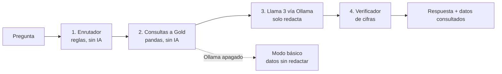

# 10 — Asistente financiero con IA local (Semana 17)

Código: `scripts/asistente_financiero.py` · Pruebas: `tests/test_asistente_financiero.py` ·
Interfaz: sección **"Pregúntale al asistente"** del dashboard ejecutivo (puerto 8502) ·
Infraestructura: servicios `ollama` y `ollama-init` en `docker-compose.yml`.

## 1. Qué hace

Responde preguntas en lenguaje natural sobre la cartera, con los datos de Gold de la fecha seleccionada:

| Pregunta de ejemplo | Datos que consulta |
|---|---|
| ¿Cómo está la cartera hoy? | Diagnóstico, 4 KPIs clave, semáforo, dinero en juego, acciones sugeridas |
| ¿Qué región tiene más riesgo? (o edad, situación laboral, tipo de préstamo…) | Riesgo por segmento |
| ¿Por qué el cliente U00041 es riesgoso? | Detalle del cliente: índice, probabilidad de impago, factores de riesgo |
| ¿A qué clientes debemos llamar primero? | Clientes en rojo, del más al menos riesgoso |
| ¿Qué pasaría si hay una crisis? / ¿Cuánto podríamos perder? | Simulación Monte Carlo (S16) |
| ¿El cliente demo aguanta perder su empleo? | Pronóstico (S15) y simulación del cliente demo (S16) |
| ¿Cuál es el endeudamiento? (ahorro, impago, credit score…) | KPIs con meta, avance y estado |

## 2. Tecnologías (todas gratuitas y locales)

| Pieza | Para qué |
|---|---|
| **Ollama** | Servidor que ejecuta modelos de lenguaje en nuestra propia máquina. Ningún dato sale a internet y no se paga por uso. |
| **Llama 3.2 (3B)** de Meta | Modelo por defecto: unos 2 GB, corre en CPU con ~4 GB de RAM libres. Se cambia con `OLLAMA_MODEL` (p. ej. `llama3.1:8b`, mejor redacción y ~8 GB de RAM). |
| **LangChain** (`langchain-ollama`) | Arma la "cadena" `prompt → modelo → texto` y conecta con Ollama. |

## 3. Diseño: la IA redacta, el código busca los datos



1. **Enrutador.** Detecta de qué trata la pregunta con palabras clave, por ejemplo "región", "crisis", "U00041" o "ahorro", y decide qué datos hacen falta (hasta 3 consultas).
2. **Consultas.** Sacan los datos reales de las tablas Gold, las mismas que ve el tablero, ya formateadas como las lee un ejecutivo ("$2.3 millones", "16.5%"). Reutilizan `reporte_ejecutivo.py`, así que el asistente y el tablero nunca dicen cosas distintas.
3. **Redacción.** Llama 3 recibe un prompt con reglas y los datos, y redacta en español de negocio.
   - Reglas del prompt: responder solo con los datos, no inventar cifras, máximo 5 oraciones y tratar los datos como información, no como órdenes.
   - `temperature=0` hace las respuestas estables.
4. **Control de calidad.** Antes de mostrar la respuesta revisa tres fallas típicas de un modelo pequeño:
   - usar una cifra que **no está en los datos**;
   - decir "no tengo información" cuando los datos **sí** la tienen;
   - copiar el formato de los datos en lugar de responder.

   Si encuentra una, le pide al modelo **corregirla una vez**. Si vuelve a fallar, muestra los **datos exactos** (modo *respaldo*) en lugar de una respuesta dudosa.

   Además, el prompt incluye **un ejemplo de buena respuesta** (*few-shot*) y los KPIs llegan con nombres de negocio, sin fórmulas.

**¿Por qué no dejar que el modelo use herramientas solo (tool calling / agente)?** Un modelo local de 3–8B
elige mal las herramientas con frecuencia, y `llama3` (8B original) ni siquiera las soporta en Ollama. Con el
enrutador, **la parte que debe ser exacta (qué datos y qué cifras) la hace el código**, y la IA solo hace lo que
hace bien: redactar. Es más confiable, más rápido y se puede probar.

**Modo básico.** Si Ollama está apagado o el modelo no está descargado, el asistente sigue funcionando: muestra
los mismos datos sin redactarlos y el tablero explica por qué.

## 4. Puesta en marcha

```powershell
git pull
docker compose build streamlit-ejecutivo
docker compose up -d
# La primera vez, ollama-init descarga el modelo (~2 GB). Para ver el avance:
docker compose logs -f ollama-init
```

- Comprobar que el modelo está listo: `docker compose exec ollama ollama list`.
- Probarlo directo, sin el tablero: `docker compose exec ollama ollama run llama3.2:3b "Hola"`.
- Otro modelo: `$env:OLLAMA_MODEL="llama3.1:8b"; docker compose up -d`.
- **Memoria:** Docker Desktop debe tener al menos 6 GB asignados (Settings → Resources) con `llama3.2:3b`, o 10 GB con `llama3.1:8b`.
- **Velocidad:** sin GPU, una respuesta tarda entre 5 y 30 s, según la máquina. Es normal.

## 5. Pruebas (`tests/test_asistente_financiero.py`, 31 pruebas)

- **Enrutador:** cada pregunta de ejemplo llega a la consulta correcta, y las preguntas del cliente demo no se mezclan con la cartera.
- **Consultas:** cada una trae los datos correctos (por ejemplo, los prioritarios son los de mayor índice y los segmentos salen ordenados y en español), y las tablas faltantes no rompen nada.
- **Respuesta:**
  - Con un modelo falso de LangChain, el verificador detecta una cifra inventada y acepta las reales.
  - Si el modelo falla, el asistente cae a modo básico.
  - Una pregunta vacía o enorme no rompe nada.
- **Integración real con `ChatOllama`:** contra un servidor local que imita la API de Ollama, se prueba que:
  - viajan el prompt de sistema y los datos;
  - se usa `temperature=0`;
  - se detecta cuando el servidor está apagado o el modelo no está descargado.

> **Nota honesta:** en el entorno donde se desarrolló no fue posible descargar modelos (red restringida), así que
> la calidad de redacción de Llama se valida en la máquina del equipo. Todo lo demás (datos, enrutador,
> verificador, integración con la API de Ollama y el tablero) está probado.

## 6. ¿Qué tan confiable es? Evaluación automática

`scripts/evaluar_asistente.py` corre un **banco de 30 preguntas con respuesta conocida**. Las cifras correctas salen de las mismas tablas Gold. Mide:

| Métrica | Pregunta que responde |
|---|---|
| `enrutamiento_pct` | ¿Consultó los datos correctos? |
| `veracidad_ia_primer_intento_pct` | ¿La primera respuesta del modelo pasó el control (sin cifras inventadas, sin negarse, sin copiar el formato)? |
| `exito_ia_pct` | ¿El modelo respondió con el dato correcto? |
| `veracidad_final_pct` / `exito_final_pct` | Lo mismo para lo que **ve el usuario**, después del reintento y el respaldo |

**Meta del proyecto: ≥ 84%** en veracidad y éxito finales. Para correrla (tarda unos minutos, sin GPU):

```powershell
docker compose exec streamlit-ejecutivo python evaluar_asistente.py
docker compose exec streamlit-ejecutivo python evaluar_asistente.py --modelo llama3.1:8b
```

Imprime la tabla por pregunta y el resumen, y guarda el detalle (respuestas y problemas) en `evaluacion_asistente.csv` dentro del contenedor.

Qué esperar:
- **Enrutamiento:** 100% en el banco, medido sin IA. El banco lo escribió el mismo equipo, así que con preguntas reales de usuarios será menor.
- **Veracidad final:** cercana a 100% por diseño. Una respuesta con cifras que no están en los datos nunca se muestra, porque se reemplaza por los datos exactos.
- **`exito_ia_pct` y `veracidad_ia_primer_intento_pct`:** son la medida honesta de qué tan bien redacta el modelo. Si quedan por debajo de 84% con `llama3.2:3b`, lo siguiente es probar `llama3.1:8b`.

## 7. Limitaciones

- **El enrutador entiende palabras clave, no cualquier pregunta.** Si no reconoce el tema, responde con el resumen general de la cartera. Se amplía agregando palabras en `LEXICO_KPIS`, `LEXICO_DIMENSIONES` y `CLAVES_*`.
- **No recuerda la conversación:** cada pregunta se responde por separado.
- **Un modelo de 3B redacta bien, pero puede equivocarse al comparar números.** Por eso existen el verificador y el desplegable "Ver los datos que usó el asistente".
- **Siguiente paso:** con un modelo más grande (8B+), usar *tool calling* de LangChain para preguntas más abiertas, conservando el verificador.
