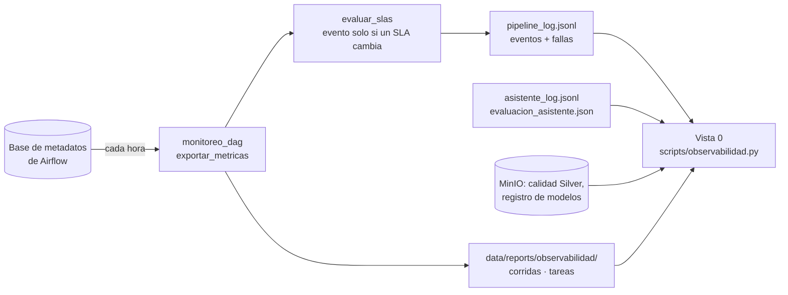

# 11 — Observabilidad y hardening (Semana 18)

Código: `scripts/observabilidad.py` · SLA: `config/slas.yml` · DAG: `dags/monitoreo_dag.py` ·
Robustez común: `dags/comun_dags.py` · Pruebas: `tests/test_observabilidad.py` ·
Dashboard: **Vista 0 — Observabilidad de la plataforma**, la primera del dashboard técnico (puerto 8501).

## 1. Qué resuelve

Antes, los problemas se descubrían cuando alguien los veía: un DAG *skipped*, Gold sin datos o el disco lleno.
Ahora la plataforma **se vigila sola**:
- mide su operación;
- la compara contra acuerdos de servicio (SLA) escritos;
- muestra alertas en un solo lugar.

## 2. Cómo funciona

- **`monitoreo_dag` (cada hora)**
  - Exporta de la base de Airflow las corridas y tareas de los últimos 30 días. El dashboard no tiene acceso directo a esa base.
  - Evalúa los SLA y registra un evento en el log **solo cuando un SLA cambia de estado**, para no repetir la misma alerta cada hora.
- **Vista 0** usa las mismas funciones que el DAG. Junta lo exportado con lo que lee en vivo: eventos, calidad, modelo y asistente.
- **Las fallas de tareas** las reporta cada DAG con `on_failure_callback`: un evento `falla_tarea` con el DAG, la tarea, el intento, el error y el enlace al log.

## 3. SLA (`config/slas.yml`, ventana de 7 días)

| SLA | Cómo se mide | Meta | Severidad |
|---|---|---|---|
| Datos listos a tiempo | Días en que Gold quedó listo antes de las 07:00 del día siguiente. Un día sin corrida cuenta como tarde | ≥ 95% | Alta |
| Corridas exitosas | Corridas terminadas con éxito, todos los DAGs de la malla | ≥ 95% | Alta |
| Calidad de Silver | Reglas cumplidas en el último reporte de cada fuente (la peor fuente) | ≥ 95% | Alta |
| Duración de Gold | Percentil 95 de la duración de `transformacion_gold_dag` | ≤ 15 min | Media |
| Modelo actualizado | Días desde el último entrenamiento (promovido o no) | ≤ 14 días | Media |
| Asistente responde con IA | Respuestas redactadas por la IA que pasaron el control de calidad (mín. 5 preguntas) | ≥ 84% | Media |
| Tiempo de respuesta del asistente | Percentil 95 (mín. 5 preguntas) | ≤ 60 s | Media |
| Exactitud del asistente | Éxito final en la última evaluación automática | ≥ 84% | Media |

**Estado de la plataforma:**
- **Crítico:** hay al menos una alerta de severidad alta.
- **Requiere atención:** solo hay alertas medias.
- **Saludable:** no hay alertas.

Un SLA sin datos suficientes queda en **Sin datos**, nunca como falla.

**Alertas abiertas:**
- SLA incumplidos;
- corridas fallidas sin una corrida exitosa posterior de la misma partición;
- tareas fallidas en las últimas 24 h.

## 4. Vista 0 en el dashboard técnico

| Bloque | Qué muestra |
|---|---|
| Resumen | Estado de la plataforma, SLA cumplidos, alertas abiertas, corridas de la semana |
| SLA | Una tarjeta por SLA: valor actual, meta y estado (icono + texto, no solo color) |
| Alertas abiertas | Severidad, origen, elemento, detalle y desde cuándo |
| Corridas | Línea de tiempo de los últimos 3 días y resumen por DAG (% de éxito, duración típica y p95) |
| Tendencias | Duración de cada DAG (un panel por DAG) y tabla de frescura día por día |
| Calidad y modelo | Calidad del último reporte por fuente contra la meta; último entrenamiento y AUC |
| Asistente IA | Preguntas, % redactado por IA, tiempos, última evaluación y últimas preguntas |

## 5. Hardening

| Cambio | Antes | Ahora |
|---|---|---|
| Límite de tiempo por tarea (`execution_timeout`) | Una tarea colgada bloqueaba la malla | Bronze 30 min, Silver y Gold 60 min, entrenamiento 120 min, monitoreo 10 min |
| Aviso de falla (`on_failure_callback`) | Solo en Bronze | En los 5 DAGs, con el mismo formato |
| Healthchecks en Docker | Solo Postgres | También MinIO, Airflow (webserver y scheduler), Ollama y ambos dashboards |
| Credenciales de MinIO | Escritas en `docker-compose.yml` | En `.env`, que no se sube a Git (`.env.example` como plantilla) |
| `bronzeAudit` | Solo en `plugins/` de una máquina; un clon nuevo no cargaba el DAG | Versionado en `scripts/`, con listado paginado (antes ignoraba lo que pasaba de 1,000 archivos) |

## 6. Validación

- **Pruebas:** 13 en `tests/test_observabilidad.py`. Cubren métricas, frescura (a tiempo, tarde, día sin corrida, días antes del proyecto), cada SLA en estado OK, ALERTA y sin datos, fallas abiertas contra resueltas, orden de alertas, estado general, registro del asistente y `bronzeAudit`.
- **`monitoreo_dag` contra una base real de Airflow 2.9.3** (sqlite, con corridas exitosas y una fallida):
  - exportó corridas y tareas;
  - calculó 83.3% de corridas exitosas y 66.7% de frescura;
  - registró 3 alertas;
  - en la segunda corrida, sin cambios, no repitió ninguna.
- **Los 5 DAGs cargan** con su timeout, reintentos y aviso de falla.

## 7. Presentación a audiencias técnicas y de negocio

### Para una audiencia técnica (~1 min)

"La plataforma ahora tiene observabilidad propia.
- Un DAG horario, `monitoreo_dag`, exporta de la base de metadatos de Airflow las corridas y tareas de 30 días.
- Ocho SLA escritos en un YAML se evalúan con el mismo módulo en el DAG y en el dashboard: frescura de Gold antes de las 7 am, ≥ 95% de corridas exitosas, p95 de Gold ≤ 15 minutos, calidad de Silver ≥ 95%, antigüedad del modelo y tres del asistente de IA.
- Las alertas combinan SLA incumplidos, corridas fallidas sin reintento exitoso y fallas de tareas, que ahora reportan todos los DAGs con un callback común. Para no generar ruido, el DAG solo registra un evento cuando un SLA cambia de estado.
- En hardening agregamos timeouts por tarea, healthchecks en todos los servicios, credenciales fuera del compose y el módulo de auditoría de Bronze versionado.
- Todo tiene pruebas: 116 en total, y el DAG se probó contra una base real de Airflow."

### Para una audiencia de negocio (~1 min)

"Antes, si algo fallaba en el proceso de datos, nos enterábamos cuando un ejecutivo veía números viejos. Ahora el sistema se vigila solo.
- Prometemos ocho compromisos de servicio. Por ejemplo, que la información del día esté lista antes de las 7 de la mañana, que al menos 95 de cada 100 procesos terminen bien y que el asistente de IA responda correctamente al menos 84% de las veces.
- Una sola pantalla dice si la plataforma está saludable, requiere atención o está en estado crítico, qué compromiso no se cumple y desde cuándo.
- Así el equipo de datos corrige antes de que el negocio lo note, y el negocio puede confiar en que los números que ve son los de hoy."

## 8. Limitaciones

- **Las alertas solo se ven en el dashboard;** no hay correo ni Teams/Slack, por decisión del proyecto. Agregar un webhook es un cambio pequeño en `comun_dags.alertar_fallo` y en `monitoreo_dag`.
- **Las corridas tienen hasta 1 hora de retraso,** porque se exportan cada hora. El resto de la Vista 0 se lee en vivo. Para verlas al momento, se dispara `monitoreo_dag` a mano.
- **En una laptop que se apaga de noche,** las corridas de medianoche no ocurren y el SLA de frescura lo va a marcar. Es correcto: el SLA mide lo que vería el negocio.
- **Quedan contraseñas por mover a `.env`:** la de Postgres de Airflow y la del usuario `airflow` siguen en el compose; las de MinIO ya se movieron.
